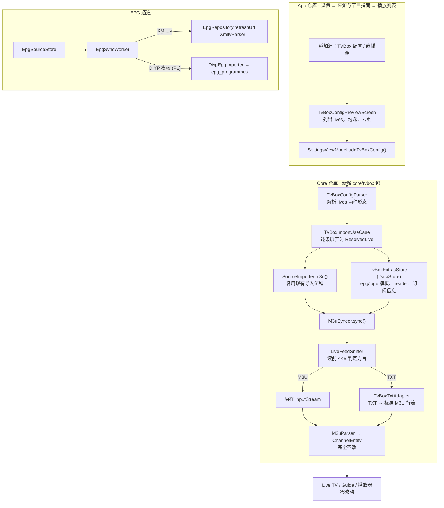
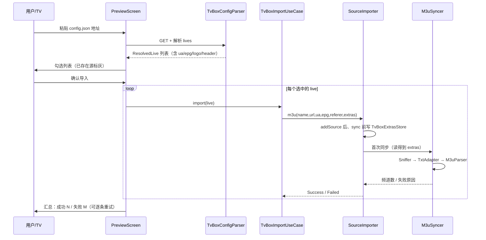

# OwnTV 兼容 TVBox 生态直播源改造方案

> 方案日期：2026-11-05 ｜ 目标入口：**设置 → 来源与节目指南 → 播放列表 → 添加源**
> 代码依据：`OwnTV`（本仓库，TV UI 层）与 `OwnTV_Core`（`E:/develop/ideaPoject/git/OwnTV_Core`，
> 数据/解析/同步/EPG/播放引擎）当前实际代码；TVBox 侧格式依据见附录 A。
> 范围：**只兼容直播源的格式与元数据**，不实现 TVBox 点播内核（见 2.4）。

---

## 目录

- [一、结论先行](#一结论先行)
- [二、现状：这条链路今天是怎么走的](#二现状这条链路今天是怎么走的)
- [三、目标格式：TVBox 生态到底有哪些写法](#三目标格式tvbox-生态到底有哪些写法)
- [四、目标与验收标准](#四目标与验收标准)
- [五、总体架构](#五总体架构)
- [六、详细改造点](#六详细改造点)
- [七、兼容矩阵](#七兼容矩阵)
- [八、实施顺序](#八实施顺序)
- [九、测试计划](#九测试计划)
- [十、待决策项与遗留风险](#十待决策项与遗留风险)
- [附录 A · TVBox 格式速查与参考](#附录-a--tvbox-格式速查与参考)
- [附录 B · 代码锚点索引](#附录-b--代码锚点索引)

---

## 一、结论先行

### 1.1 一句话方案

**P0 不新增源类型、不新增 Room 列、不改解析器核心**：在「添加源」里增加一条
「TVBox 配置 / 直播源」入口，把 TVBox 的配置 JSON 展开成若干个现有的 M3U 播放列表，
把 TVBox 风格 TXT 在**字节流层**翻译成标准 M3U（`#EXTM3U` / `#EXTINF`）再交给现有
`M3uParser` → `M3uSyncer`。EPG 与台标模板单独作为 EPG 源 / 同步期元数据接入。

> 这里的「源类型」指持久化的 `SourceType`（进数据库、进备份）；UI 私有的 `SourceKind`
> 是另一回事，可以新增一项（见 6.3）。

### 1.2 三条设计原则

| 原则 | 说明 | 避免的代价 |
|---|---|---|
| **归一，不分支** | TVBox 的 TXT、内联频道组、配置 JSON 全部转换成「标准 M3U 行流」或「若干 M3U 源」 | 不用在 `M3uParser`、`M3uSyncer`、`ChannelEntity`、播放器里到处加 `if (tvbox)` |
| **复用 `SourceType.M3U`** | TVBox 直播源本质就是「一个 URL 指向一个频道列表」，差异只是方言 | 不用改 `SourceType` 的十余处 `when` 穷举分支、备份格式、旧版本兼容 |
| **P0 零 Room 变更** | 格式靠**内容嗅探**判定，扩展元数据放 DataStore | 不用写 `MIGRATION_53_54`（当前 `version = 53`，`DatabaseModule` 只挂 `ALL_MIGRATIONS`、无破坏性迁移）；P0 备份暂不携带这些元数据（可由配置地址重建），P1 再补 |

### 1.3 分期路线

| 阶段 | 交付能力 | 改动面 |
|---|---|---|
| **P0 · 可用** | 粘贴 TVBox 配置地址 / TXT 地址 → 预览并批量导入；分组、多线路主线路、UA/Referer/自定义 header 生效；EPG 为 XMLTV 时自动登记；本地 `.txt`/`.json` 文件可选 | Core 新增 1 个包 + 3 处小改；App 新增 1 个预览页 + 表单字段 |
| **P1 · 好用** | DIYP JSON 节目单模板（`{name}`/`{date}`）；台标模板 `{name}`；配置订阅定期刷新（增删 lives 自动同步）；单频道自动换线路 | Core EPG/同步/播放器；App EPG 表单；仅「自动换线」需要 Room v54 |
| **P2 · 生态** | 台标映射 JSON、多仓 `urls` 递归、Base64/加密配置、GBK 自动识别、批量线路测速排序 | 独立增强，可与 P0/P1 并行评估 |

### 1.4 明确不做什么

- **不跑 `spider`**（`spider.jar` / `csp_*` / `js` 爬虫）、不实现 `sites` 点播站源、`parses` 解析接口、
  `flags`、`doh`、`proxy` —— 这些是 TVBox 的**点播内核**，与直播源无关，且在 Android TV 上加载
  第三方可执行代码有安全与合规风险。
- **不内置任何第三方配置地址、直播源或 EPG 服务**。只做格式兼容，内容合法性由用户负责。
- **不承诺兼容 TVBox 全部衍生分支**：`lives` 字段没有正式规范，按「未知字段忽略、缺失字段降级」实现。

### 1.5 改动规模（文件数，不含测试）

| 仓库 | 新增 | 修改 | 主要工作量 |
|---|---|---|---|
| Core | 7 个文件 | P0 4 个（`M3uSyncer`、`SourceTester`、`SourceImporter`、`di/AppModule`）；P1 再加 EPG 侧 3 个 | 配置解析、TXT 适配、内联源落盘 |
| App | 1 个预览页 | 6 个（`AddSourceScreen`、`AddSourceChooserScreen`、`ManageSourcesScreen`、`SettingsViewModel`、`SettingsHelpTable`、`SettingsScreen`） | TV 焦点、批量导入状态、帮助/搜索条目 |
| 资源 | — | 12–18 条新文案 × 语言变体 | 文案在 Core 仓库的 `strings.xml` |

不含 P1 的 DIYP 导入器与自动换线。

---

## 二、现状：这条链路今天是怎么走的

### 2.1 添加源 → 频道落库（App 仓库）

| 环节 | 代码锚点 | 现状 |
|---|---|---|
| 分组入口 | `features/shell/components/SettingsScreen.kt` / `features/settings/SettingsHelpTable.kt` | 「Sources & guide」分组，含播放列表、EPG 源等 |
| 播放列表页 | `features/settings/ManageSourcesScreen.kt` | 承载 `AddSourceChooserScreen` / `AddSourceScreen`，保存时调 `vm.addM3u(...)` |
| 添加方式选择 | `features/setup/AddSourceChooserScreen.kt` | 两行：**从手机填** / **在此输入** |
| 表单 | `features/setup/AddSourceScreen.kt` | `SourceKind { XTREAM, M3U, STALKER }`；M3U 只有 1 个 URL 字段 + 本地文件选择（`StorageBrowser`，仅 `.m3u/.m3u8`）；公共可选字段为 UA、Referer、EPG URL、自动刷新、默认播放列表 |
| 提交 | `features/settings/SettingsViewModel.kt` `addM3u()` | `runImport { importer.m3u(...) }`，成功后按 `epgRepository.guideUrl()` 询问是否同步指南 |
| 首次安装 | `features/setup/SetupWizard.kt` / `SetupViewModel.kt` `startM3u()` | 复用同一个 `AddSourceScreen`，回调签名一致 |
| 手机端 | Core `companion/CompanionHtml.kt` / `CompanionHttpProtocol.kt` / `CompanionPayload.kt` | 三个 tab；`type` 字符串映射 `SourceType`；M3U 表单可上传文件或填 URL |

### 2.2 导入 → 解析 → 落库（Core 仓库）

| 环节 | 代码锚点 | 现状 |
|---|---|---|
| 导入编排 | `setup/SourceImporter.kt` `m3u()` | 识别 `get.php` 形式的 Xtream 链接；否则 `addM3uSource(...)` → `runImport` → 同步 |
| 源实体 | `database/entity/ProfileEntities.kt` `SourceEntity` | `type: SourceType`、`url`、`userAgent`、`httpReferer`、`epgUrl`、各类按源覆盖；`model/Enums.kt` 中 `SourceType { M3U, XTREAM, LOCAL_BACKUP, STALKER }` |
| 连接测试 | `repository/SourceTester.kt` `testM3u()` | 只读开头一段（`PLAYLIST_PROBE_BYTES`），必须以 `#EXTM3U` 开头，否则返回 `SourceTestResult.AuthFailed` |
| 同步调度 | `sync/SyncManager.kt` / `sync/M3uSyncer.kt` | `M3uSyncer.sync()` 按 `s.url` 前缀分本地文件 / HTTP，流式解析，按 `name␁group` 生成稳定键，同名重复自动加 `␁#n` |
| 解析 | `parser/M3uParser.kt` | 逐行；只认 `#EXTINF` 属性 + 紧随的 URL 行；已支持 `tvg-id`、`tvg-name`、`tvg-logo`、`tvg-chno`、`group-title`、`url-tvg`、`catchup*`、`#EXTVLCOPT`/`#EXTHTTP`/`#KODIPROP`/`url\|Key=Value` 头、DRM、manifest type |
| 频道实体 | `database/entity/ContentEntities.kt` `ChannelEntity` | **`streamUrl` 单值**；另有 `logoUrl`、`epgChannelId`、`httpHeaders`、`directSource`（仅 Xtream 兜底） |
| EPG | `epg/EpgSourceStore.kt`（DataStore JSON）、`repository/EpgRepository.kt` `refreshUrl()`、`parser/XmltvParser.kt` | **只吃 XMLTV**；`EpgSource { id, name, url, userAgent, ... }`，`guideUrls()` 支持逗号分隔多个 XMLTV；`EpgSyncWorker` 每次 GET 一个 feed |
| EPG 匹配 | `epg/EpgMatcher.kt` / `EpgAutoMatcher.kt` | 缺 `tvg-id` 时按频道名归一化 + 打分匹配，已有「自动匹配 EPG」 |
| 播放重试 | `player-core/.../player/LiveLadder.kt` | 阶梯是 **引擎 × 格式**（Exo/mpv × HLS/TS）四维，**没有「换备用 URL」这一维** |

### 2.3 关键差距（为什么 TVBox 源现在直接填进去会失败）

| # | 差距 | 后果 |
|---|---|---|
| G1 | `M3uParser` 要求 `#EXTINF` + URL 行 | TVBox TXT 的 `分组,#genre#` / `频道名,http://…` 被当作「无 pending 的杂行」**全部丢弃**，同步结果 0 频道 |
| G2 | `SourceTester.testM3u` 只认 `#EXTM3U` | TXT / 配置 JSON 返回 `AuthFailed`，UI 显示为认证失败 |
| G3 | 表单只有一个 URL，没有「配置地址」概念 | 用户拿到的是 `config.json`，里面 `lives[]` 才是真正的播放列表；手动逐个抄不现实 |
| G4 | `ChannelEntity.streamUrl` 单值 | TVBox 的 `url1#url2` 多线路无处安放；`LiveLadder` 也不会换线 |
| G5 | EPG 只有 XMLTV 下载一种模型 | `epg` 是 `?ch={name}&date={date}` 模板（DIYP JSON，按频道请求）时完全不工作 |
| G6 | `logo` 是 `{name}` 模板，不是 URL | 台标全部缺失（TVBox 源通常不带 `tvg-logo`） |
| G7 | UA / header 只有 UA + Referer 两栏 | `lives[].ua`、`lives[].header`（JSON 头）无处填写；`HttpClient.get()` 其实已支持任意 header map，只是没接出来 |
| G8 | `SourceType` 在多处穷举 `when` | 新增枚举值要改 `SyncManager`、`SourceTester`、`EpgRepository.guideUrl`、`CompanionHttpProtocol`、备份恢复、`AddSourceScreen` 等至少 6 处；旧版本还会读不懂新类型的备份 |
| G9 | Room `version = 53`，只注册 `ALL_MIGRATIONS`（无破坏性迁移） | 新增列必须写 `MIGRATION_53_54` 并同步备份/本地同步，成本高 |
| G10 | i18n / 设置搜索有门禁 | `app/build.gradle.kts` 的 `verifyI18nLiterals` 禁止硬编码 UI 文案；`SettingsSearchCoverageTest` 要求新增设置行有搜索条目；字符串实际由 **Core 仓库**持有 |

### 2.4 边界：TVBox 的哪一部分算「直播源」

TVBox 一份配置 JSON 里同时有点播与直播两套东西：

```
spider / sites / parses / flags   → 点播内核（不兼容）
lives[]                          → 直播源（本方案的目标）
  ├ 外链型：{ name, type, url, playerType, epg, logo, ua, header }
  └ 内联型：{ group, channels: [ { name, tvg_name, urls: [...] } ] }
urls[]                           → 多仓订阅（P2 可选）
```

---

## 三、目标格式：TVBox 生态到底有哪些写法

### 3.1 配置 JSON 的 `lives[]`

**外链型**（最常见，占生态绝大多数）：

```json
{
  "spider": "https://example/spider.jar;md5;…",
  "sites": [ { "key": "xx", "name": "xx", "type": 3, "api": "…" } ],
  "lives": [
    {
      "name": "范明明·ipv6",
      "type": 0,
      "url": "https://example/live/ipv6.m3u",
      "playerType": 1,
      "epg": "http://epg.112114.xyz/?ch={name}&date={date}",
      "logo": "https://live.fanmingming.com/tv/{name}.png",
      "ua": "okhttp/3.15"
    }
  ]
}
```

**内联频道组型**（不引用外部文件，直接把频道写在配置里）：

```json
"lives": [
  {
    "group": "卫视",
    "channels": [
      {
        "name": "东方卫视",
        "tvg_name": "东方卫视",
        "urls": [ "http://…/rtp/239.3.1.136:8032", "http://…/0018_1.m3u8" ]
      }
    ]
  }
]
```

字段语义与 OwnTV 的映射（未知字段一律忽略）：

| TVBox 字段 | 含义 | OwnTV 落点 |
|---|---|---|
| `name` | 源显示名 | `SourceEntity.name`（经 `SourceImporter.uniqueName`） |
| `url` | M3U / TXT / 相对路径 | `SourceEntity.url`，相对路径按配置 URL 绝对值化 |
| `type` | 0/1，分支语义不一 | **忽略**（仅日志） |
| `playerType` | 1/2 播放器选择 | **忽略**；OwnTV 有自己的引擎策略（`EnginePreference` / `LiveLadder`） |
| `ua` | 全局 UA | `SourceEntity.userAgent` |
| `header` | JSON 字符串或对象，请求头 | `Referer` 进 `SourceEntity.httpReferer`，其余进 `TvBoxExtrasStore.extraHeaders`（见 6.1 / 6.2） |
| `epg` | XMLTV 地址 **或** `{name}`/`{date}` 模板 | XMLTV → 自动登记 EPG 源；模板 → P1 DIYP 导入器 |
| `logo` | `{name}` 模板 / 台标映射 JSON | 同步期展开写入 `ChannelEntity.logoUrl`（P1） |
| `group` / `channels` | 内联频道组 | 展开成一份**本地生成的 M3U**，作为一个 M3U 源导入 |
| `url` 里含多个列表地址（少数分支） | 一个字段写多个地址 | P2 再按 `#` / 逗号拆分；P0 遇到时提示 |

### 3.2 列表文件的两种方言

| 方言 | 样例 | OwnTV 现状 |
|---|---|---|
| 标准 M3U | `#EXTM3U` / `#EXTINF:-1 tvg-id="1" group-title="央视",CCTV-1 综合` / URL | ✅ 完整支持 |
| TVBox 风格 TXT | `央视频道,#genre#`（分组行）、`CCTV1,http://a/1.m3u8#http://b/1.m3u8`（多线路）、`url$1920×1080`（`$` 后为注释） | ❌ 0 频道 |

TXT 的现实变体必须在**适配器**里兜住：`#EXTINF` 与 TXT 混写、`#` 既作线路分隔又作注释、
UTF-8 BOM / GBK、相对路径、频道名里含逗号、空行与「更新时间,#genre#」这类伪分组。

### 3.3 EPG 的两种形态

| 形态 | 请求 | 返回 | OwnTV 现状 |
|---|---|---|---|
| XMLTV | `GET …/e.xml` 或 `.xml.gz` | `<tv><channel id=…><programme start=…>` | ✅ `XmltvParser`，gzip 由 OkHttp 处理 |
| DIYP JSON 模板 | `GET …?ch={name}&date={date}` | `{"channel_name":"CCTV1","date":"2026-11-05","epg_data":[{"start":"19:00","end":"19:30","title":"新闻联播","desc":"…"}]}` | ❌ 无 |

DIYP 的关键差异：**它是按频道、按天逐个请求的 API，不是一份可下载的 feed**，
与现有「一个 EPG 源 = 一次 GET = 一次全量解析」模型正交，必须单独设计导入器（见 6.4）。

---

## 四、目标与验收标准

### 4.1 用户故事（P0）

1. 用户在「添加源」选择「TVBox 配置 / 直播源」，用手机填表或遥控器粘贴一个 `config.json` 地址。
2. 应用拉取并解析配置，展示 `lives[]` 列表（名称、类型、频道源地址、EPG/台标模板），可勾选。
3. 确认后，每一条 live 变成一个普通 M3U 播放列表，沿用现有的同步进度、默认源、自动刷新。
4. 若 live 的 URL 指向 TVBox 风格 TXT，同步时自动按分组导入频道，多线路至少主线可用。
5. 若 `epg` 是 XMLTV 地址，沿用现有「是否现在同步节目指南」询问；若是 DIYP 模板，P0 明确提示
   「此节目单为按频道接口，暂不支持；可先用 XMLTV 指南代替」，不静默失败、也不假装已导入。
6. 直接粘贴 `.m3u` / `.m3u8` / 本地 M3U 文件的老路径，**行为与今天完全一致**。

### 4.2 可测验收项

| # | 验收项 | 判定 |
|---|---|---|
| A1 | 配置 JSON（外链型，3 条 lives）导入 | 生成 3 个源，UA / EPG / 名称正确，逐源同步互不阻塞 |
| A2 | 配置 JSON（内联 `group/channels/urls`）导入 | 生成 1 个源，分组与频道数正确 |
| A3 | TVBox TXT（含 `#genre#`、`#` 多线路、`$` 注释、BOM） | 频道数 = 有效频道行数，分组名 = `#genre#` 前的名称，URL 无 `$` 后缀 |
| A4 | 相对路径 live / 相对频道 URL | 按配置 URL / 列表 URL 正确绝对值化 |
| A5 | 连接测试 | TXT、配置 JSON 不再误报「认证失败」；坏 URL 仍给出准确错误 |
| A6 | 内嵌 `tvg-id` / 无 `tvg-id` | 前者直接命中 EPG，后者走现有 `EpgAutoMatcher` 按名称匹配 |
| A7 | 重复导入同一配置 | 按归一化 URL 去重，不产生重复源；提示「已存在」 |
| A8 | 回归 | Xtream / 标准 M3U / Stalker 添加、编辑、重同步、备份恢复、设置搜索测试全绿 |
| A9 | 门禁 | `verifyI18nLiterals` 通过；`SettingsSearchCoverageTest` / lint / 单测通过 |

---

## 五、总体架构

### 5.1 分层：归一化发生在「字节流层」



**最关键的取舍**：不让 `M3uParser` 认识 TXT。它现在是逐行流式的，注释以十万级播放列表为
优化目标（`M3uSyncer` 的注释里出现过 34 万条的实例），`parseAttrs` 是单次扫描、逐行计时只在
debug 下开启；在其中塞方言分支风险高、收益低。
适配器只需把 TXT 变成合法 M3U 文本行，下游所有稳定键、hash-diff、分批 upsert、EPG 匹配、
分类创建逻辑**一行都不用改**。

### 5.2 三个关键决策

| 决策 | 选择 | 备选（不推荐） | 理由 |
|---|---|---|---|
| 源类型 | 继续用 `SourceType.M3U` | 新增 `SourceType.TVBOX` | 避免 2.3-G8 的穷举分支扩散；TVBox 直播源在 OwnTV 眼里就是一个 M3U 播放列表；旧版本备份仍可读 |
| 格式识别 | **每次同步按内容嗅探**，不落库 | `SourceEntity.format` 新列 / 按 URL 后缀硬编码 | 源随时可能从 TXT 换成 M3U，嗅探自愈；零 Room 迁移；后缀在生态里极不可靠（`.txt` 里可能是 M3U） |
| 扩展元数据 | `TvBoxExtrasStore`（DataStore，按 sourceId 索引） | 给 `SourceEntity` 加 6 个列 | Room 当前 v53 且全为显式迁移；DataStore 已是 EPG 源、按源设置的既有做法，备份易扩展 |

### 5.3 格式嗅探（`LiveFeedSniffer`）

读取前 4 KB（带 BOM 剥离），按优先级判定：

| 判定 | 特征 | 处理 |
|---|---|---|
| `CONFIG` | 首字符 `{` / `[`，或 JSON 里出现 `"lives"` | 交给 `TvBoxConfigParser`（仅在「添加源」阶段；同步期出现则报错提示「这是配置地址，请从 TVBox 入口导入」） |
| `M3U` | 去 BOM 后以 `#EXTM3U` / `#EXTINF` 开头 | 原样透传 |
| `TXT` | 出现 `,#genre#`；或存在「非 `#` 开头、含逗号、逗号后紧跟 `http(s)://`」的行 | `TvBoxTxtAdapter` |
| `XMLTV` | 出现 `<tv>` | 仅在 EPG 侧使用 |
| `UNKNOWN` | 其他 | 保持现状交给 M3U 解析器（记日志 + 0 频道时的可读错误） |

`SourceTester.testM3u()` 改为调用同一个嗅探器：`TXT` / `CONFIG` 都返回 `Ok()`（地址可达、
格式可识别）。`SourceTestResult` 不新增字段，提示由 UI 侧按 sniff 结果补一句
「这是配置地址，请从 TVBox 入口导入」。只有 `UNKNOWN` 才走原来的
「不是 `#EXTM3U` → AuthFailed」判定，避免 2.3-G2 的误报。

### 5.4 TXT → M3U 适配器规则（`TvBoxTxtAdapter`）

输入是 `InputStream`，输出仍是 `InputStream`（可用 `Sequence` + `ByteArrayInputStream` 逐段生成，
或自定义 `InputStream` 包装原 reader，避免把大文件读进内存）。

| 输入行 | 输出 |
|---|---|
| `央视频道,#genre#` | 记录当前分组，不输出；后续 `#EXTINF` 写 `group-title="央视频道"` |
| `CCTV1,http://a/1.m3u8#http://b/1.m3u8` | `#EXTINF:-1 group-title="央视频道" tvg-name="CCTV1",CCTV1` + 主线路 URL；开关打开时输出多条同名条目 |
| `CCTV1,http://a/1.m3u8$1920×1080` | 剥离 `$` 及其后描述，URL 只留 `http://a/1.m3u8` |
| `CCTV-1 综合,http://…/1.m3u8`（无 tvg-id） | 不伪造 `tvg-id`，只写 `tvg-name` 与显示名，留给 `EpgAutoMatcher` |
| 频道名含半角逗号（`CCTV-1,综合`） | 显示名里的 `,` 换成 `，`，原名保留在 `tvg-name`（`M3uParser` 按引号外第一个逗号切分） |
| 已存在的 `#EXTINF` / `#EXTM3U` / `#EXTVLCOPT` | 原样透传（支持混写文件） |
| 以 `#` 开头但不是 M3U 指令 | 当注释丢弃 |
| 相对路径 `/rtp/x` / `./x.ts`，协议相对 `//host/x` | 按列表 URL 的 scheme + host 绝对值化 |
| BOM / GBK | P0 剥离 UTF-8 BOM 并按 UTF-8 解码；P2 再用已有 `juniversalchardet` 探测 GBK |

属性值里的双引号没有标准转义：`group-title` / `tvg-name` 中出现 `"` 时替换为 `'`，
否则 `M3uParser.parseAttrs` 会在该引号处把值截断（见 6.7）。

转换示例：

```text
【输入 TVBox TXT】                          【输出给 M3uParser 的 M3U】
央视频道,#genre#                      →     #EXTM3U
CCTV1,http://a/1.m3u8#http://b/1.m3u8 →     #EXTINF:-1 group-title="央视频道" tvg-name="CCTV1",CCTV1
                                              http://a/1.m3u8
CCTV2,http://a/2.m3u8$高清           →     #EXTINF:-1 group-title="央视频道" tvg-name="CCTV2",CCTV2
                                              http://a/2.m3u8
```

注意：`#EXTM3U` 必须在第一行输出，否则 `M3uHeader.urlTvg` 拿不到 `url-tvg`（现有逻辑会把
XMLTV 地址回写到 `SourceEntity.epgUrl`，正好可复用：TXT 源若自带 `#EXTM3U url-tvg="…"`，
不需要任何 EPG 侧改动）。

### 5.5 导入时序



失败隔离很重要：一个失效 live 不能让整批配置导入回滚；每条独立 `runImport`，结果汇总，
失败条目展示原因并可单条重试（与 `SettingsViewModel.lastFailedSource` 的现有重试体验一致）。

另一个实现约束：`SourceImporter.state` 是**全局单例的 StateFlow**，逐条导入时会被下一条覆盖，
不能靠轮询它来区分每条结果。给 `SourceImporter` 加一个返回 `Result<SourceEntity>` 的
`m3uAndAwait(...)`（内部复用 `runImport`），`TvBoxImportUseCase` 收集它来汇总；UI 的
`state` 仍只负责显示「正在导入第 N 条」。

---

## 六、详细改造点

### 6.1 Core 仓库 · 新增文件

> 路径相对 `OwnTV_Core/core/src/main/java/tv/own/owntv/core/`

| 文件 | 职责 | 关键 API |
|---|---|---|
| `tvbox/TvBoxModels.kt` | 配置与解析结果模型 | `TvBoxConfig`、`ExternalLive`、`InlineLiveGroup`、`InlineChannel`、`ResolvedLive`、`TvBoxExtras`、`FeedFormat`、`EpgTemplate` |
| `tvbox/TvBoxConfigParser.kt` | 解析当前配置的 `lives` 双形态、相对 URL、`header` 归一化；P0 **不递归** `urls[]` 多仓 | `parse(text, baseUrl): TvBoxConfig` |
| `tvbox/LiveFeedSniffer.kt` | 前 4 KB 嗅探方言，供同步与连接测试共用；用 `BufferedInputStream.mark/reset`（或把已读字节与剩余流拼回）保证**不消费**这 4 KB | `sniff(input): FeedFormat` |
| `tvbox/TvBoxTxtAdapter.kt` | TXT → 标准 M3U 行流 | `wrap(input, baseUrl, multiLinePolicy): InputStream` |
| `tvbox/TvBoxInlinePlaylistWriter.kt` | 内联 `group/channels` → app 私有目录的 `.m3u`（`SourceEntity.url` 需要一个真实地址）；文件名用 `liveKey` 的 hash，与 sourceId 无关，避免「先有源 id 才能写文件」的循环依赖 | `write(live): File` / `deleteBySource(sourceId)` |
| `tvbox/TvBoxImportUseCase.kt` | 配置 → 若干源；去重、失败隔离、Extras 写入 | `import(config, selected, onEach): ImportSummary` |
| `tvbox/TvBoxExtrasStore.kt` | DataStore：按 sourceId 存模板与订阅信息 | `put/get/remove` |
| `epg/DiypEpgImporter.kt`（P1） | DIYP JSON → 现有 `epg_*` 表 | `import(storeId, template, channels, dates)` |

核心模型草图：

```kotlin
enum class FeedFormat { M3U, TVBOX_TXT, CONFIG_JSON, XMLTV, UNKNOWN }

data class InlineChannel(
    val name: String,
    val tvgName: String?,
    val urls: List<String>,             // 已按配置 URL 绝对值化
)

data class ResolvedLive(
    val name: String,
    val url: String,                    // 已绝对值化；内联型指向本地生成的 .m3u
    val userAgent: String?,
    val headers: Map<String, String>,   // header 字段展开
    val epg: String?,                   // XMLTV URL 或 DIYP 模板
    val logoTemplate: String?,          // {name} 模板
    val inlineChannels: List<InlineChannel> = emptyList(),
    val sourceConfigUrl: String?,       // 来自哪个订阅，供刷新与清理用
)

data class TvBoxExtras(
    val configUrl: String?,
    val configHash: String?,
    val epgTemplate: String?,
    val logoTemplate: String?,
    val extraHeaders: String?,          // StreamHeaders.encode 后的字符串
    val liveKey: String?,               // lives[] 中的规范 URL，去重/刷新用
    val inlinePlaylistPath: String?,    // 内联型生成的文件，删除源时清理
)
```

### 6.2 Core 仓库 · 修改点

| 文件 | 改动 | 影响面 |
|---|---|---|
| `sync/M3uSyncer.kt` | 把「打开 `s.url` 得到 InputStream」抽成 `openPlaylistStream(s)`：HTTP/本地分支不变，之后串接 `LiveFeedSniffer`（`mark/reset`，不能吞掉前 4 KB）+ `TvBoxTxtAdapter`；同步开始时按 `sourceId` 读 `TvBoxExtras`，`extraHeaders` 并入播放列表下载请求头；`flushChannels()` 里按 `logoTemplate` 展开 `logoUrl`（P1） | 4 处：读 extras、下载请求头、解析前包适配器、构造 `ChannelEntity` |
| `repository/SourceTester.kt` | `testM3u()` 调 `LiveFeedSniffer`：`TXT` / `CONFIG` 判 `Ok()`（提示由 UI 侧加，不改 `SourceTestResult`），只有 `UNKNOWN` 才走原来的 `AuthFailed` | 单函数 |
| `setup/SourceImporter.kt` | `m3u()` 增加可选 `tvBoxExtras`；在 `runImport` 的 `addSource` lambda 内、**`sourceRepository.sync(...)` 之前**写入 `TvBoxExtrasStore`，保证首次同步就能读到 header / 模板；构造函数注入 `TvBoxExtrasStore` | 构造函数 + `di/AppModule` 注册；`cleanupFailedAdd` 一并清理 extras 与内联文件 |
| `repository/SourceRepository.kt` | `addM3uSource()` 保持原样（`httpReferer` 已支持）；extras 由 `SourceImporter` 在 add 之后直接写 store，不经 Repository | 无需新增方法 |
| `network/HttpClient.kt` | **无需改动**：`get(url, userAgent, headers=…)` 已支持任意头 | — |
| `epg/EpgSourceStore.kt`（含 `EpgSource`）/ `EpgSourceJson.kt`（P1） | 给 `EpgSource` 加 `kind: EpgKind`（默认 `XMLTV`）与 `headers`；JSON 用 `optString("kind")` 读取；`add/ensure/update` 带上；`exportJson/importJson/mergeJson` 自动携带 | 旧备份缺字段时回落 XMLTV，向后兼容 |
| `repository/EpgRepository.kt`（P1） | 把 `private suspend fun writeProgrammes(...)` 提为 `internal`（或抽出 `EpgProgrammeWriter`），供 DIYP 导入器复用；`refreshUrl()` 的 XMLTV 路径不动 | 1 个可见性 + 1 个共用类 |
| `sync/work/EpgSyncWorker.kt`（P1） | 按 `source.kind` 分派：`XMLTV` 走 `epgRepository.refreshUrl()`，`DIYP` 走 `DiypEpgImporter`（不改 `EpgRepository` 的构造与职责） | 一个 `when` + 注入导入器 |
| `parser/M3uParser.kt` | **P0 不改**。P1 可选：支持 `#EXTGRP` 分组指令 | — |

> 双仓库协同：`settings.gradle.kts` 通过 `libs.owntv.core`（固定版本）依赖 Core，
> 本地可用 `~/.gradle/gradle.properties` 的 `owntv.corePath` 走 composite build。
> 因此 P0 必须**先在 Core 仓库落地并发布/本地联调**，再改 App；两个仓库的版本号要一起推进。
> 新增的 `tvbox/*` 类必须是 **public**（Core 模块对外 API），`internal` 只适合 Core 内部实现，
> 否则 App 的预览页调不到。

### 6.3 App 仓库 · 修改点

| 文件 | 改动 |
|---|---|
| `features/setup/AddSourceChooserScreen.kt` | 增加第三行「从 TVBox 配置导入」（或并入「在此输入」的类型选择，见下）；新增行需同步 `SettingsHelpTable.kt` 帮助条目与 `SettingsSearchEntry` 搜索条目，否则 `SettingsSearchCoverageTest` 失败 |
| `features/setup/AddSourceScreen.kt` | `SourceKind` 是 UI 私有枚举，可新增 `TVBOX`（不影响 `SourceType`、备份、同步分支）；字段：配置/列表地址、UA、`header`（JSON）、EPG、自动刷新；`StorageBrowser` 的 `fileExtensions` 扩到 `m3u/m3u8/txt/json`；长 URL 交给手机填表 |
| `features/settings/TvBoxConfigPreviewScreen.kt`（新增） | 复用 `StageFullPage` / `StageSettingRow` 的 TV 交互范式：lives 列表、勾选、已存在标记、导入进度、失败重试；遥控器只做「全选 / 确认」，长 URL 交给手机端 |
| `features/settings/SettingsViewModel.kt` | 新增 `addTvBoxConfig(url)`、`importSelectedLives(...)`；沿用 `runImport` 的 TV Home 刷新与 EPG 询问逻辑 |
| `features/settings/ManageSourcesScreen.kt`、`features/setup/SetupWizard.kt` / `SetupViewModel.kt` | 接新回调；向导里可隐藏 TVBox 入口（首次安装保持极简），或提供同一个入口 |
| `features/settings/EpgSourceForm.kt` / `EpgSourcesViewModel.kt`（P1） | EPG 类型选择（XMLTV / DIYP 模板）、模板变量帮助文案、`add/update` 带 `kind` |
| Core `companion/CompanionHtml.kt` / `CompanionHttpProtocol.kt` / `CompanionPayload.kt` | 增加第 4 个 tab「TVBox」：配置 URL + 可选 UA/EPG；或最小改动——允许把配置 URL 直接贴进 M3U 的 `server` 字段，由 `TvBoxImportUseCase` 嗅探后走配置流程。`CompanionPayload` 增加 `configUrl` 字段即可，不改 `SourceType` 映射 |
| 字符串资源（Core 仓库 `core/src/main/res/values/strings.xml`） | 新增文案先进 Core 的 `strings.xml` 再走翻译流程；App 的 `tools/i18n` 检查脚本会拦截 Kotlin 里的硬编码字面量（App 仓库只有 5 个 `values-*` 覆盖目录） |
| `app/src/test/...`、`app/src/androidTest/...` | 设置搜索覆盖测试、ViewModel 导入状态测试 |

### 6.4 DIYP 节目单导入器（P1，最需要设计的部分）

**问题**：DIYP 模板是 `?ch={name}&date={date}`，一次只返回一个频道一天的节目；
而 `EpgRepository.refreshUrl()` 的模型是「一次 GET → 一次流式全量解析 → 按 storeId 覆盖」。
直接把模板当 URL 请求会得到语法错误或空数据。

**设计**：

1. `EpgSource.kind = DIYP`，`url` 原样保存模板（备份可读、优先级 `GuidePriority` 复用）。
2. `EpgSyncWorker` 触发时按 `source.kind` 分派到 `DiypEpgImporter`：
   - 先取当前活跃 profile 的 sourceIds（`ProfileSourceCrossRef`），再用
     `ChannelDao.allForSources(sourceIds, limit)` 拿频道；优先 `epgChannelId`，其次
     `ChannelEntity.matchName`（已有 `providerName`，避免「清理频道名」后匹配失败）；
   - 默认只请求**今天**；打开「前后各一天」时才 ×3，范围仍受 `guideAheadMs()` 约束；
   - `{name}` 用 `URLEncoder.encode(name, UTF-8)`（空格会编码成 `+`，服务要求 `%20` 时替换），
     `{date}` 默认 `yyyy-MM-dd`，兼容 `yyyyMMdd` 需按服务探测；
   - 并发上限 4、单请求超时 5 s、总请求上限 600（约 200 频道 × 3 天），超出按最近观看排序截断；
   - 写 `epg_channels` 的 key 用**请求时用的那个名字**（频道已有的 `epgChannelId`，否则归一化名），
     不要用响应里的 `channel_name`，否则同一频道两次同步会得到两个 key。频道原本没有
     `epgChannelId` 时，靠现有「自动匹配 EPG」（`EpgAutoMatcher`）把频道指过来：建议 DIYP 同步
     完成后自动跑一次，同时保留 UI 里的手动入口；
   - 每条响应转成一个「虚拟 XMLTV 事件」：`EpgChannelEntity(epgChannelId = 归一化频道名)`
     + 若干 `EpgProgrammeEntity`，`start/end` 用 `HH:mm` 结合 `date` 转毫秒，跨零点节目补一天；
   - **复用** `ProgrammeHashTracker` / `writeProgrammes()` / `FeedDedupe`（`writeProgrammes`
     目前是 private，需提为 `internal`），写入同一套 `epg_channels` / `epg_programmes`，
     `storeId = EpgSource.id`（负 id），因此 Guide 的优先级、now/next、追看、提醒、
     录制规则**全部不用改**；`EpgChannelEntity` 的 `normName` / `normId` 用
     `EpgMatcher.normalizeForEpg` 填，与 XMLTV 路径保持一致。
3. **失败隔离与限流**：单个频道失败只记 `lastError` 摘要，不整体失败；默认关闭自动刷新，
   首次添加时明确提示「该接口会按频道发起 N 次请求」并让用户确认；结果按频道缓存 12 小时，
   避免公共 EPG 服务被打爆。
4. **备选降级**：若模板地址同时也是 XMLTV 服务（`?type=gz` 之类），可先探测一次不带 `ch` 的
   响应，若为 `<tv>` 直接走现有 `XmltvParser`，省掉 N 次请求。

### 6.5 多线路：分两步，不要一次到位

| 方案 | 做法 | 评价 |
|---|---|---|
| P0 · 主线优先 | `TvBoxTxtAdapter` 只输出第一条 URL；在预览页显示「共 N 条线路，已导入主线」；高级开关「把每条线路拆成独立频道」时输出多条同名 `#EXTINF`（`M3uSyncer.stableKey` 自动变 `name␁group␁#n`） | 零 schema、零播放器改动；缺点是拆频道会让频道数 ×N、EPG 自动匹配重复 |
| P1 · 自动换线 | 新增 `channels.alternateUrls`（Room v54 + `MIGRATION_53_54`），同步时把备用 URL 写入；`LiveLadder` 增加「URL 维度」rung（当前是 `EXO_HLS/EXO_TS/MPV_HLS/MPV_TS`），失败后换下一个 URL 并**重置**引擎/格式阶梯；HUD 增加「换线路」菜单 | 体验对齐 TVBox；要动 player-core、Room、备份，成本明显更高 |

拆成独立频道后能否用现有「Sources」菜单切换，取决于它是否按频道名跨条目聚合；
若只聚合同一 source 内的版本，则仍需 P1 的 `alternateUrls`。

建议 P0 默认主线优先 + 提供开关，P1 再做自动换线。理由：TVBox 源的线路失效率很高，
主线优先能让绝大多数用户立刻用起来；自动换线涉及播放失败语义与 `LiveLadder` 的
「每个 rung 至多一次」有限性保证，必须配单元测试，不宜塞进首期。

### 6.6 存储、备份与去重

- **Room：P0 完全不动**（无新列、无 migration）。
- **DataStore `TvBoxExtrasStore`**：一个 JSON map，key = `sourceId.toString()`，value 见 6.1 模型。
  写入时机为 `SourceImporter` 的 `addSource` 之后、首次同步之前（见 6.2）；删除源时在
  `SourceRepository.deleteSource()` 内注入 store 清理，同时删掉内联型生成的本地 `.m3u`，
  不依赖调用方记得清理。
- **备份/恢复（P1）**：P0 不携带 extras（丢失后可由配置地址重建，普通 M3U 不受影响）。
  P1 在 `features/settings/BackupViewModel.kt` 的 sources 段新增 extras 导出/导入，restore 时
  按 `sourceId` 重绑（照 `EpgSourceStore.mergeJson()` 的 `idMap` 模式）；旧备份缺该段时按普通
  M3U 处理。
- **去重键**：`liveKey = 规范化(live.url)`（去 fragment、统一 scheme/host 大小写、去尾部斜杠）；
  同一配置重复导入时按 `liveKey` 查 `TvBoxExtrasStore`，命中即标灰「已存在」。
- **订阅刷新（P1）**：保存 `configUrl` + `configHash`，在 `CatalogSyncWorker` 的自动刷新前先重拉配置，
  对 `lives[]` 做 diff：新增 → 导入；消失 → **只提示，不自动删除**（避免配置临时出错清空用户的源）；
  变更 → 更新 `SourceEntity.url` 并触发重同步。注意 `SourceEditor.needsResync()` 目前只比较
  `url/username/password/mac…`，URL 变化时会自动重同步，正好复用。

**首次同步的元数据时序（容易踩坑）**：`SourceImporter.runImport` 的顺序是
`addSource(profileId)` → `setPlaylistAutoRefresh` → `sourceRepository.sync(...)`。
所以 extras 必须在 `addSource` 的 lambda 内、`addM3uSource` 返回 id 之后立刻写。
若等 `runImport` 返回再写，首次同步读不到 `extraHeaders` / `logoTemplate`，表现就是
「UA 和请求头都填了，第一次同步仍 403，第二次才正常」。

### 6.7 安全与健壮性清单

| 风险 | 对策 |
|---|---|
| 第三方配置指向 `file://` / `content://` / 内网地址（SSRF） | 远端配置解析出的 live URL 只允许 `http/https`；`127.0.0.1` / 局域网地址需用户二次确认（TVBox 配置确实存在本地代理服务，不能一刀切禁止） |
| 超大/恶意配置 | 配置体上限 2 MB、JSON 深度上限 8、`lives` 上限 200、内联频道上限 5 万；超时复用 `HttpClient` |
| 编码 | UTF-8 BOM 先剥离；乱码用 `juniversalchardet` 探测 GBK（P2 可做成默认） |
| 请求头注入 | `header` 字段按 `StreamHeaders.canonicalName()` 规范化，并拒绝 `Host`/`Content-Length`/`Connection`/`Transfer-Encoding`/`Range` 等保留头 |
| 批量导入阻塞 UI | 串行 + 可取消；每条独立事务；进度沿用 `SourceImporter.ImportState` |
| 频道名 / 分组名含逗号、双引号 | M3U 没有转义机制：显示名里的半角逗号换成 `，`（原名留 `tvg-name`）；属性值里的 `"` 换成 `'`。否则 `displayName` 会截断、`parseAttrs` 会错位 |
| 合规 | 不内置任何源；UI 帮助文案说明「仅解析用户自行提供的地址，内容合法性由用户负责」 |

---

## 七、兼容矩阵

| TVBox 能力 | 现状 | P0 | P1 | P2 / 不做 | 主要落点 |
|---|---|:---:|:---:|:---:|---|
| 标准 M3U / M3U8 列表 | ✅ | ✅ | ✅ | — | 现有 `M3uParser` |
| `lives[]` 外链型配置 | ❌ | ✅ | ✅ | — | `TvBoxConfigParser` + 预览页 |
| `lives[]` 内联 `group/channels/urls` | ❌ | ✅ | ✅ | — | `TvBoxInlinePlaylistWriter` 写入 app 私有目录 |
| TVBox TXT（`#genre#`） | ❌ | ✅ | ✅ | — | `TvBoxTxtAdapter` |
| TXT 多线路 `url1#url2` | ❌ | 主线（可拆频道） | 自动换线 | 测速排序 | `TvBoxTxtAdapter` / `LiveLadder` |
| `$` 后缀注释 / 相对路径 / BOM | ❌ | ✅ | ✅ | GBK | `TvBoxTxtAdapter` |
| `ua` / `header` | 部分 | ✅ | ✅ | — | `SourceEntity.userAgent` / `httpReferer` / `StreamHeaders` |
| `epg` = XMLTV 地址 | ✅（手动 / `url-tvg`） | 自动登记 | ✅ | — | `EpgSourceStore.ensure()` |
| `epg` = DIYP `{name}/{date}` 模板 | ❌ | 明确提示不兼容 | ✅ | — | `DiypEpgImporter` |
| `logo` = `{name}` 模板 | ❌ | 忽略 | ✅ | 映射 JSON | `M3uSyncer.flushChannels()` |
| `tvg-id` / `tvg_name` | ✅ | ✅ | ✅ | — | `M3uParser` / `EpgAutoMatcher` |
| 频道名模糊匹配 EPG | ✅ | ✅ | ✅ | — | 现有 `EpgMatcher` |
| `type` / `playerType` | — | 忽略 | 忽略 | — | 仅日志 |
| 配置订阅自动刷新 | ❌ | 手动重导 | ✅ | — | `CatalogSyncWorker` diff |
| 多仓 `urls[]` / Base64 / 加密配置 | ❌ | — | — | P2 评估 | `TvBoxConfigParser` 扩展 |
| `spider` / `sites` / `parses` / `flags` | — | — | — | **不做** | 点播内核，见 1.4 |
| 内网/本地代理型 live（`127.0.0.1:35457`） | ❌ | 允许（确认后） | ✅ | — | 安全白名单 |
| 备份 / 本地同步携带 TVBox 元数据 | ❌ | 不携带（可重建） | ✅ | — | `BackupViewModel` + `TvBoxExtrasStore` |

---

## 八、实施顺序

| 里程碑 | 内容 | 依赖 | 完成标志 |
|---|---|---|---|
| **M0 · Core 解析层** | 新增 `core/tvbox` 的 models / config parser / sniffer / txt adapter，配套 JVM 单测 | 无 | 单元用例全绿，能把样例 TXT 变成合法 M3U 文本 |
| **M1 · Core 接入** | `M3uSyncer` 流适配、`SourceTester` 嗅探、`SourceImporter.m3u()` 可选参数、`TvBoxExtrasStore` | M0 | 用现有「添加 M3U」页面直接填一个 TXT 地址，能同步出频道（此时 UI 未改、也没有 extras，正好先验证基础链路） |
| **M2 · App 入口** | 预览页 + ViewModel + 表单字段 + 手机端 tab + 帮助/搜索/i18n 条目 | M1，`owntv.corePath` 本地联调或 Core 发版 | A1–A7 验收通过 |
| **M3 · 回归与门禁** | 全量回归、备份/本地同步、lint、i18n 门禁、真机 TV 焦点验证 | M2 | A8–A9 通过 |
| **M4 · P1a** | DIYP 导入器、logo 模板、配置订阅刷新 | P0 稳定 | DIYP 节目单在 Guide 正常显示，台标出现 |
| **M5 · P1b** | 自动换线：`channels.alternateUrls` + `MIGRATION_53_54` + `LiveLadder` 的 URL 维度 | P0 稳定；可独立分支，与 M4 并行 | 主线失败能切备用线路，阶梯「每 rung 至多一次」的测试仍绿 |

> M1 的设计刻意让核心能力**先于 UI 落地并可独立验证**：只改 Core 后，用户把 TXT 地址填进现有
> M3U 输入框就能工作。这既降低联调风险，也让 P0 的「UI 层」退化成纯交互工作。
> 双仓库发布顺序：Core 先合入并发版 → 更新 App 的 `gradle/libs.versions.toml` 中 `owntvCore` → 再合 App。

### 8.1 回滚与灰度

- 按 D2 的建议，P0 的入口只出现在「设置 → 播放列表 → 添加源」；出问题时只回滚 App 的入口行即可。
  Core 侧的嗅探与适配对现有 M3U 是「原样透传」，不需要一起回滚。
- `TvBoxExtrasStore` 是新增的 DataStore 文件，删掉不影响任何现有源；内联源生成的 `.m3u`
  在 app 私有目录，删除源时清理，残留也只是几个小文件。
- 不建议再加全局 feature flag：入口本身就是开关，flag 会多一份设置页、搜索与测试的固定开销。

---

## 九、测试计划

### 9.1 Core JVM 单测（新增）

| 测试类 | 用例 |
|---|---|
| `TvBoxConfigParserTest` | 外链型 / 内联型 / 两种混排；未知字段忽略；`header` 字符串与对象两种写法；相对 URL 与 `../`；空 `lives`；超上限；非法 JSON 不抛异常到 UI |
| `LiveFeedSnifferTest` | BOM + `#EXTM3U`；`,#genre#`；`名称,http…`；配置 JSON；`<tv>`；HTML 错误页 → `UNKNOWN` |
| `TvBoxTxtAdapterTest` | 分组切换；`#` 多线路（主线 / 拆分两种策略）；`$` 后缀；混写 `#EXTINF`；相对路径；频道名含逗号；空行与注释；输出首行必须是 `#EXTM3U`；`group-title` 含引号时转义 |
| `TvBoxImportUseCaseTest` | 重复 liveKey 去重；单个 live 失败不影响其余；`uniqueName` 冲突；**首次同步前 extras 已写入**（header 确实带到了 playlist 下载请求） |
| `TvBoxInlinePlaylistWriterTest` | 写入 / 覆盖 / 删除；只落在 app 私有目录；重导同一源不残留旧文件 |
| `TvBoxSecurityTest` | 远端配置里的 `file://` / `content://` 被拒；内网地址需确认；2 MB / 200 lives 上限；HTML 错误页不崩溃 |
| `DiypEpgParserTest`（P1） | `HH:mm` 转毫秒、跨零点、`date` 两种格式、空 `epg_data`、`desc` 缺失、频道名 URL 编码 |
| `M3uSyncer` 回归 | 现有 M3U 样例的 stable key / hash / prune 结果**与改动前一致**（等价快照测试） |

### 9.2 App 测试与门禁

- `SettingsSearchCoverageTest` / `SettingsSearchRowsTest`：新增行必须有搜索条目与帮助条目。
- `SettingsViewModel` 导入状态：成功 / 部分失败 / 取消 / 断网。
- `verifyI18nLiterals`（`preBuild` 钩子）：所有新文案走 `strings.xml`；`lint` 的 `PluralsCandidate`
  对「成功 N 个 / 失败 M 个」这类计数句有强制要求，需用 `pluralStringResource`。
- 数据库回归：P0 无 schema 变更，需验证覆盖安装后 v53 的既有源/频道/EPG 数据完整；P1 若加 `alternateUrls` 列，必须补当时下一版的 `MIGRATION_53_54`（或对应版本）迁移测试。

### 9.3 真机 / TV 交互验证

1. 遥控器焦点：预览页长列表的上下滚动、全选/确认按钮的 `FocusRequester`、返回键层级
   （`ManageSourcesScreen` 现有 `onBack` 状态机有 `showAdd` / `editingSource` / `addMode` 三层，新增页要接进同一状态机）。
2. 手机端填表（Remote companion）：配置 URL 提交后能正确预填 TV 端表单并触发预览。
3. 本地文件：`StorageBrowser` 选 `.txt` / `.json`，`LocalPlaylistFile` 能读 `content://`。
4. 断网 / 404 / 返回 HTML 错误页时，错误文案可读且不误报「账号失效」。
5. 大配置（100+ lives、5 万频道 TXT）导入内存与耗时，确认仍走流式、不 OOM。
6. 内联源：导入后删除源 / 重新导入配置，确认 app 私有目录里的 `.m3u` 被清理或覆盖。

### 9.4 回归清单

Xtream 添加/编辑/HLS 探测、标准 M3U 导入与重同步（收藏/历史/进度不丢）、Stalker 门户、
EPG 源增删改与优先级、自动刷新、备份导出/导入/合并恢复、TV Home 频道行、设置搜索、
24 语言文案缺失检查。

---

## 十、待决策项与遗留风险

### 10.1 需要产品确认的三件事

| # | 问题 | 建议 |
|---|---|---|
| D1 | P0 是否提供「把每条线路拆成独立频道」开关？ | 提供，默认关。默认只导主线避免频道列表膨胀；高级用户可自行开启 |
| D2 | 首次安装向导是否暴露 TVBox 入口？ | 向导隐藏，仅在设置里出现。新用户看到 4 种源类型会增加认知负担 |
| D3 | DIYP 接口默认开启还是显式确认？ | 显式确认并默认关闭自动刷新：按频道请求会打公共 EPG 服务，需要用户知情 |

### 10.2 遗留风险

| 风险 | 说明 | 缓解 |
|---|---|---|
| TVBox 分支碎片化 | `lives` 没有正式规范，`header`/`epg`/`logo` 的类型在不同分支里可能是字符串、对象或数组 | 解析全部走 `opt*` + 类型兜底，未知即忽略；收集真实失败样本迭代 |
| 公共 EPG 服务不可用 | DIYP 常用的 `epg.112114.xyz` / `51zmt` 等服务稳定性差 | 多 EPG 源优先级机制已存在；失败按频道隔离；允许多个 XMLTV 兜底 |
| 双仓库版本不同步 | Core 与 App 分开仓库、固定版本依赖 | 本地用 `owntv.corePath` composite build 联调；发布清单里锁定 Core 版本 |
| 翻译工作量 | 字符串由 Core 仓库持有，约 24 个语言变体 | P0 新增约 12–18 条文案（入口、字段、预览页、错误提示），其余复用现有「播放列表 / EPG / 请求头」文案 |
| 多线路语义 | 拆成独立频道会改变稳定键，收藏/历史可能落在不同条目上 | 默认不拆；P1 用 `alternateUrls` 保留单一频道身份 |
| 线路探测/测速 | 自动换线若不做连通性预检，可能每条都超时，体验反而更差 | P1 换线前先做 HEAD/小段 GET 探测，并限定每次 tune 最多换 2 条 |
| 内联源跨设备恢复 | 内联型的 `SourceEntity.url` 指向本机 app 私有目录，备份到另一台设备后路径无效 | P0 恢复时标记「内联源需重新导入配置」；P1 备份携带 `inlineChannels`，恢复时重写文件 |

---

## 附录 A · TVBox 格式速查与参考

**配置骨架**（`lives` 双形态、模板变量）：

```json
{
  "spider": "…", "sites": [], "parses": [], "flags": [],
  "lives": [
    { "name": "直播1", "type": 0, "url": "https://…/list.txt", "playerType": 1,
      "epg": "http://…/?ch={name}&date={date}", "logo": "https://…/logo/{name}.png",
      "ua": "okhttp/3.15" },
    { "group": "卫视", "channels": [
        { "name": "东方卫视", "tvg_name": "东方卫视", "urls": ["http://…/a.m3u8", "http://…/b.m3u8"] }
    ] }
  ],
  "urls": [ { "url": "https://…/repo.json", "name": "多仓" } ]
}
```

**TXT 方言**：`分组名,#genre#` 开分组；`频道名,url1#url2` 多线路；`url$说明` 后缀忽略；
`#EXTINF` 可混写；`{name}` / `{date}` 是 EPG 与台标模板变量（不是 TXT 的一部分）。

**DIYP 响应**：

```json
{ "channel_name": "CCTV1", "date": "2026-11-05",
  "epg_data": [ { "start": "19:00", "end": "19:30", "title": "新闻联播", "desc": "" } ] }
```

参考资料（仅用于确认字段语义，非项目依赖）：

- TVBox `lives` 配置结构（外链型 / 内联型 / EPG、台标模板变量）：
  <https://deepwiki.com/hl128k/tvbox/4.1-live-tv-configuration>
- 直播源字段与 `playerType` / `ua`：`XC.json` 配置说明
  <https://deepwiki.com/yoursmile66/TVBox/2.3-live-streaming-configuration>
- 实际配置示例（AList-TvBox）：<https://github.com/gaoshuais/alist-tvbox-new/blob/master/doc/README_zh.md>
- 配置地址填写流程：<https://www.tvbox.org/thread-32958-1-1.html>
- TVBox 风格 TXT 与 M3U 格式对比：<https://blog.gitcode.com/907a7f82548f973d98fb5b233c286296.html>
- DIYP JSON EPG 接口字段：<https://blog.duya233.top/2025/63349>

## 附录 B · 代码锚点索引

**App 仓库**：`features/...` 相对 `app/src/main/java/tv/own/owntv/`；构建文件按仓库根路径列出。

```
features/setup/AddSourceChooserScreen.kt      添加方式两行
features/setup/AddSourceScreen.kt             SourceKind 与全部表单字段
features/setup/SetupWizard.kt / SetupViewModel.kt   向导复用
features/settings/ManageSourcesScreen.kt      播放列表页状态机
features/settings/SettingsViewModel.kt        addM3u / runImport / updateSource
features/settings/EpgSourceForm.kt           EPG 源表单
features/settings/EpgSourcesViewModel.kt     EPG 源增删改与同步调度
features/settings/SettingsHelpTable.kt       帮助表（新增行必改）
features/shell/components/SettingsScreen.kt  设置根行 / 搜索条目
features/settings/BackupViewModel.kt         备份恢复（P1 需扩展）
app/build.gradle.kts                         verifyI18nLiterals 门禁
gradle/libs.versions.toml                    owntvCore 版本
settings.gradle.kts                          owntv.corePath composite build
```

**Core 仓库**：`core/...` 相对 `core/src/main/java/tv/own/owntv/core/`；`player-core/...` 是同一仓库的独立模块。

```
model/Enums.kt                               SourceType
database/entity/ProfileEntities.kt           SourceEntity
database/entity/ContentEntities.kt           ChannelEntity / computeContentHash
database/OwnTVDatabase.kt                    version = 53，显式迁移
setup/SourceImporter.kt                      m3u() / xtream() / stalker()
repository/SourceRepository.kt               addM3uSource / deleteSource
repository/SourceTester.kt                   testM3u()
repository/EpgRepository.kt                  guideUrl / guideUrls / refreshUrl
sync/SyncManager.kt / M3uSyncer.kt           同步主链路 / stableKey
parser/M3uParser.kt / XmltvParser.kt         两个流式解析器
parser/XtreamM3uLink.kt                      get.php 识别
network/HttpClient.kt / StreamHeaders.kt     HTTP 与请求头
epg/EpgSourceStore.kt / EpgSourceJson.kt     EPG 源 DataStore + 备份格式
epg/EpgMatcher.kt / EpgAutoMatcher.kt        频道 ↔ EPG 匹配
sync/LocalPlaylistFile.kt                    本地列表读取
sync/work/EpgSyncWorker.kt / CatalogSyncWorker.kt   后台同步
companion/CompanionHtml.kt / CompanionHttpProtocol.kt / CompanionPayload.kt   手机填表
player-core/src/main/java/tv/own/owntv/player/LiveLadder.kt   播放重试阶梯
```
